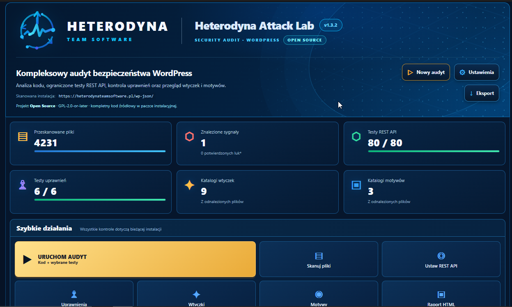

# Heterodyna Attack Lab

**Audyt bezpieczeństwa WordPress w przejrzystym panelu administratora.**

Wersja **v1.3.2** · WordPress · Open Source

[**📦 Pobierz wtyczkę — Releases**](https://github.com/HeterodynaTeamSoftware/Heterodyna-Attack-Lab/releases) · [Strona projektu](https://heterodynateamsoftware.pl/projekty/heterodyna-attack-lab/) · [Zgłoś problem](https://github.com/HeterodynaTeamSoftware/Heterodyna-Attack-Lab/issues)

## Podgląd interfejsu

*Oryginalny zrzut kokpitu programu v1.3.2. Widoczne wartości odnoszą się do przedstawionego skanu, nie są deklaracją wyników każdej instalacji.*

## O projekcie

**Heterodyna Attack Lab** to narzędzie do przeglądu bezpieczeństwa własnej instalacji WordPress. W jednym miejscu łączy analizę plików, ograniczone testy REST API, kontrolę uprawnień oraz przegląd zainstalowanych wtyczek i motywów.

### Najważniejsze możliwości

- **Skanowanie plików** — licznik przeanalizowanych plików i podsumowanie wykrytych sygnałów.
- **REST API** — uruchamianie ograniczonych testów endpointów i podgląd wyniku kontroli.
- **Uprawnienia** — osobna kontrola uprawnień WordPressa.
- **Wtyczki i motywy** — inwentaryzacja elementów wykrytych w instalacji.
- **Kokpit i szybkie działania** — rozpoczęcie nowego audytu, przejście do ustawień i eksport wyników.
- **Raportowanie** — dostęp do wyników audytu i raportu HTML.

Wykryty **sygnał** nie oznacza automatycznie potwierdzonej podatności. Wyniki należy zweryfikować w kontekście konkretnej witryny.

## Instalacja

1. Otwórz [**GitHub Releases**](https://github.com/HeterodynaTeamSoftware/Heterodyna-Attack-Lab/releases).
2. Pobierz paczkę instalacyjną **ZIP wtyczki**, gdy zostanie udostępniona.
3. W WordPressie przejdź do **Wtyczki → Dodaj nową → Wyślij wtyczkę na serwer**.
4. Zainstaluj i aktywuj wtyczkę, a następnie uruchom audyt z panelu administracyjnego.

Przed audytem warto wykonać kopię zapasową. Aktywne testy HTTP uruchamiaj tylko na własnych lub wyraźnie autoryzowanych instalacjach; przy testach obciążających używaj środowiska testowego.

## Projekt i społeczność

Masz pomysł, pytanie lub błąd do zgłoszenia? Skorzystaj z [GitHub Issues](https://github.com/HeterodynaTeamSoftware/Heterodyna-Attack-Lab/issues). Nie publikuj tam sekretów, danych użytkowników ani wrażliwych logów.

**Autor:** [Heterodyna Team Software](https://heterodynateamsoftware.pl/) · **Licencja:** GPL-2.0-or-later (zgodnie z oznaczeniem w interfejsie v1.3.2).